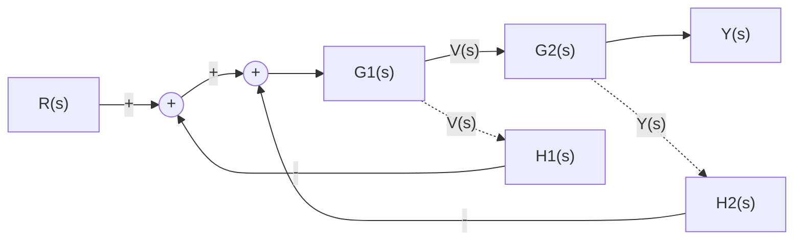
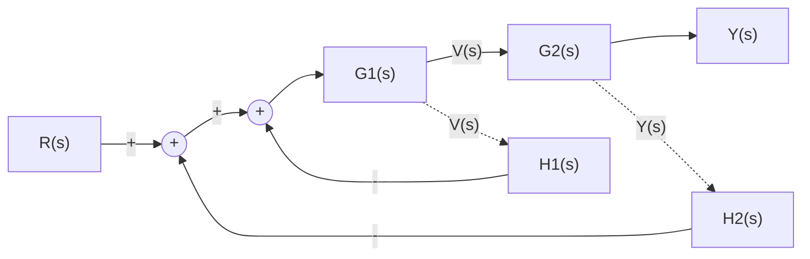
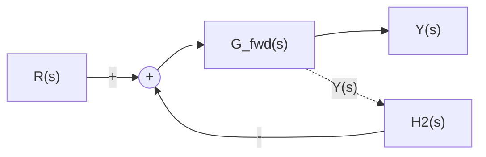
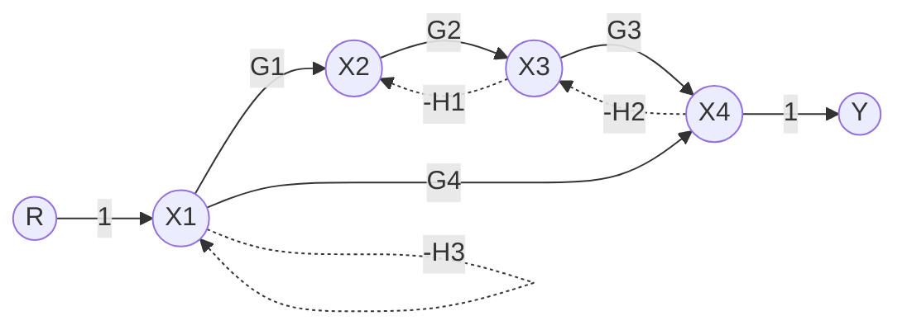
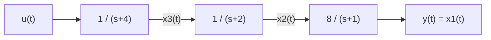
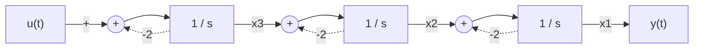

# Lembar Latihan dan Pembahasan Lengkap
## Topik Lanjutan: Diagram Blok, SFG, dan Realisasi Bentuk Kanonik Lanjut (Setara No. 9--15)
**Mata Kuliah:** MA4171 Teori Kontrol Linear --- FMIPA ITB

---

### **No. 1**

**Soal:**  
Diberikan sistem kendali lup tertutup dengan dua lup umpan balik yang bersilangan (*crossing/interconnected feedback loops*) sebagai berikut:

(a) Lakukan dekomposisi diagram blok dengan menukar urutan titik penjumlahan yang bersebelahan untuk mengeliminasi persilangan lup.  
(b) Tentukan fungsi transfer ekuivalen lup dalam hasil penataan ulang tersebut.  
(c) Tentukan fungsi transfer lingkar tertutup total $T(s) = \frac{Y(s)}{R(s)}$ dengan aljabar diagram blok bertahap.

**Penyelesaian:**

**(a) Eliminasi Persilangan Lup via Pertukaran Titik Penjumlahan**

Perhatikan bahwa titik penjumlahan $\sum_1$ dan $\sum_2$ terhubung langsung secara seri tanpa adanya penguatan blok di antara keduanya. Sifat penjumlahan aljabar bersifat komutatif dan asosiatif:
$$E_2(s) = [R(s) - H_1(s)V(s)] - H_2(s)Y(s) = [R(s) - H_2(s)Y(s)] - H_1(s)V(s)$$
Oleh karena itu, urutan kedua simpul penjumlahan dapat ditukar posisinya: sinyal umpan balik $H_2(s)Y(s)$ dimasukkan ke simpul penjumlahan pertama di sebelah kiri, sedangkan sinyal umpan balik $H_1(s)V(s)$ dimasukkan ke simpul penjumlahan kedua di sebelah kanan.

Setelah pertukaran dilakukan, persilangan antar-lup tereliminasi dan diagram terurai menjadi struktur dua lup bersarang murni:

**(b) Reduksi Lup Bagian Dalam**

Lup bagian dalam kini terisolasi secara sempurna, dibentuk oleh titik penjumlahan kedua, blok maju $G_1(s)$, dan jalur umpan balik negatif $H_1(s)$.
Fungsi transfer lingkar tertutup ekuivalen untuk lup dalam ini adalah:
$$G_{in}(s) = \frac{V(s)}{E_1(s)} = \frac{G_1(s)}{1 + G_1(s) H_1(s)}$$

Dengan mengganti sub-lup dalam tersebut dengan satu blok tunggal $G_{in}(s)$, blok $G_{in}(s)$ terhubung secara seri (kaskade) dengan blok $G_2(s)$:
$$G_{fwd}(s) = G_{in}(s) \cdot G_2(s) = \frac{G_1(s) G_2(s)}{1 + G_1(s) H_1(s)}$$

Diagram blok tersederhana menjadi lup umpan balik tunggal:

**(c) Reduksi Lup Luar dan Fungsi Transfer Total**

Sistem pada tahap ini merupakan lingkar tertutup kanonik tunggal dengan jalur maju $G_{fwd}(s)$ dan umpan balik negatif $H_2(s)$:
$$T(s) = \frac{Y(s)}{R(s)} = \frac{G_{fwd}(s)}{1 + G_{fwd}(s) H_2(s)} = \frac{\frac{G_1(s) G_2(s)}{1 + G_1(s) H_1(s)}}{1 + \left( \frac{G_1(s) G_2(s)}{1 + G_1(s) H_1(s)} \right) H_2(s)}$$

Mengalikan pembilang dan penyebut dengan $(1 + G_1(s) H_1(s))$ menghasilkan fungsi transfer lingkar tertutup total:
$$T(s) = \frac{Y(s)}{R(s)} = \frac{G_1(s) G_2(s)}{1 + G_1(s) H_1(s) + G_1(s) G_2(s) H_2(s)}$$

---

### **No. 2**

**Soal:**  
Diberikan diagram aliran sinyal (*Signal Flow Graph*, SFG) dengan dua lintasan maju dan tiga loop sebagai berikut:

(a) Tentukan seluruh lintasan maju (*forward paths*) dan penguatannya ($P_k$).  
(b) Tentukan seluruh loop individual ($L_j$) dan pasangan loop yang tidak saling bersentuhan (*non-touching loops*).  
(c) Hitung determinan graf $\Delta$ dan kofaktor lintasan $\Delta_k$.  
(d) Tentukan fungsi transfer total $\frac{Y(s)}{R(s)}$ menggunakan Aturan Penguatan Mason.

**Penyelesaian:**

**(a) Lintasan Maju**

Terdapat dua lintasan maju dari simpul masukan $R$ ke simpul keluaran $Y$:
Lintasan pertama melalui seluruh simpul utama secara berurutan:
$$P_1 = (1) \cdot G_1 \cdot G_2 \cdot G_3 \cdot (1) = G_1 G_2 G_3$$

Lintasan kedua memintas dari $X_1$ langsung menuju $X_4$ melalui cabang $G_4$:
$$P_2 = (1) \cdot G_4 \cdot (1) = G_4$$

**(b) Loop Individual dan Pasangan Non-Touching**

Tiga loop individual teridentifikasi pada graf:
$$L_1 = -G_2 H_1 \quad (\text{melibatkan simpul } X_2, X_3)$$
$$L_2 = -G_3 H_2 \quad (\text{melibatkan simpul } X_3, X_4)$$
$$L_3 = -H_3 \quad (\text{self-loop pada simpul } X_1)$$

Analisis sentuhan antar-loop:
Loop $L_1$ dan $L_2$ saling bersentuhan di simpul $X_3$.
Loop $L_3$ hanya berada di simpul $X_1$, sehingga $L_3$ tidak berbagi simpul dengan $L_1$ maupun dengan $L_2$.
Pasangan dua loop yang tidak saling bersentuhan adalah:
$$L_1 L_3 = (-G_2 H_1)(-H_3) = G_2 H_1 H_3$$
$$L_2 L_3 = (-G_3 H_2)(-H_3) = G_3 H_2 H_3$$

Tidak terdapat kombinasi tiga loop yang saling lepas secara simultan.

**(c) Determinan Graf dan Kofaktor**

Determinan graf dihitung berdasarkan rumus Mason:
\begin{align*}
    \Delta &= 1 - \sum L_j + \sum L_j L_k \\
    &= 1 - (L_1 + L_2 + L_3) + (L_1 L_3 + L_2 L_3) \\
    &= 1 + G_2 H_1 + G_3 H_2 + H_3 + G_2 H_1 H_3 + G_3 H_2 H_3
\end{align*}

Kofaktor lintasan dihitung dengan meninjau loop yang tidak menyentuh lintasan maju terkait:
Lintasan maju $P_1$ melewati simpul $X_1, X_2, X_3, X_4$, sehingga menyentuh seluruh loop:
$$\Delta_1 = 1$$

Lintasan maju $P_2$ melewati simpul $X_1$ dan $X_4$, sehingga menyentuh loop $L_3$ (di $X_1$) dan loop $L_2$ (di $X_4$). Namun, $P_2$ sama sekali tidak menyentuh simpul $X_2$ maupun $X_3$, sehingga tidak menyentuh loop $L_1$:
$$\Delta_2 = 1 - L_1 = 1 - (-G_2 H_1) = 1 + G_2 H_1$$

**(d) Fungsi Transfer Total via Aturan Mason**

Fungsi transfer total dihitung melalui perbandingan penguatan lintasan berbobot kofaktor terhadap determinan graf:
$$\frac{Y(s)}{R(s)} = \frac{P_1 \Delta_1 + P_2 \Delta_2}{\Delta} = \frac{G_1 G_2 G_3 (1) + G_4 (1 + G_2 H_1)}{1 + G_2 H_1 + G_3 H_2 + H_3 + G_2 H_1 H_3 + G_3 H_2 H_3}$$

---

### **No. 3**

**Soal:**  
Diberikan fungsi transfer rasional bertipe *proper* dengan derajat pembilang sama dengan derajat penyebut:
$$G(s) = \frac{3s^3 + 25s^2 + 62s + 44}{s^3 + 6s^2 + 11s + 6}$$
(a) Pisahkan fungsi transfer ke dalam bentuk jumlahan konstanta *direct feedthrough* $D$ dan bagian rasional sejati (*strictly proper*) $G_{sp}(s)$.  
(b) Tentukan representasi ruang keadaan dalam Bentuk Kanonik Keterkontrolan (CCF) menggunakan metode variabel perantara $Z(s)$.  
(c) Tentukan representasi ruang keadaan dalam Bentuk Kanonik Keterobservasian (OCF).  
(d) Buktikan secara matematis bahwa $C(sI - A)^{-1} B + D = G(s)$.

**Penyelesaian:**

**(a) Pembagian Polinomial dan Pemisahan Nilai $D$**

Derajat pembilang dan penyebut sama-sama bernilai 3. Pembagian langsung polinomial dilakukan:
$$3s^3 + 25s^2 + 62s + 44 = 3(s^3 + 6s^2 + 11s + 6) + (7s^2 + 29s + 26)$$

Fungsi transfer dinyatakan sebagai:
$$G(s) = 3 + \frac{7s^2 + 29s + 26}{s^3 + 6s^2 + 11s + 6} = D + G_{sp}(s)$$
dengan konstanta *direct feedthrough* $D = 3$, koefisien sisa pembilang $b_1' = 7, b_2' = 29, b_3' = 26$, dan koefisien penyebut $a_1 = 6, a_2 = 11, a_3 = 6$.

**(b) Konstruksi Bentuk Kanonik Keterkontrolan (CCF)**

Variabel perantara skalar $Z(s)$ diterapkan pada komponen rasional sejati:
$$Z(s) = \frac{U(s)}{s^3 + 6s^2 + 11s + 6} \implies \dddot{z}(t) = -6z(t) - 11\dot{z}(t) - 6\ddot{z}(t) + u(t)$$

Variabel-variabel keadaan didefinisikan sebagai rantai turunan berurutan:
$$x_1(t) = z(t), \quad x_2(t) = \dot{z}(t), \quad x_3(t) = \ddot{z}(t)$$

Diferensiasi variabel keadaan menghasilkan:
$$\dot{x}_1(t) = x_2(t)$$
$$\dot{x}_2(t) = x_3(t)$$
$$\dot{x}_3(t) = -6x_1(t) - 11x_2(t) - 6x_3(t) + u(t)$$

Persamaan sinyal keluaran total diperoleh dari kombinasi pembilang sisa dan jalur langsung:
$$y(t) = 26z(t) + 29\dot{z}(t) + 7\ddot{z}(t) + 3u(t) = 26x_1(t) + 29x_2(t) + 7x_3(t) + 3u(t)$$

Dalam notasi matriks CCF:
$$A_{ccf} = \begin{bmatrix} 0 & 1 & 0 \\ 0 & 0 & 1 \\ -6 & -11 & -6 \end{bmatrix}, \quad B_{ccf} = \begin{bmatrix} 0 \\ 0 \\ 1 \end{bmatrix}$$
$$C_{ccf} = \begin{bmatrix} 26 & 29 & 7 \end{bmatrix}, \quad D_{ccf} = 3$$

**(c) Konstruksi Bentuk Kanonik Keterobservasian (OCF)**

Berdasarkan sifat dualitas ruang keadaan, matriks OCF diperoleh dari transposisi representasi CCF:
$$A_{ocf} = A_{ccf}^T = \begin{bmatrix} 0 & 0 & -6 \\ 1 & 0 & -11 \\ 0 & 1 & -6 \end{bmatrix}, \quad B_{ocf} = C_{ccf}^T = \begin{bmatrix} 26 \\ 29 \\ 7 \end{bmatrix}$$
$$C_{ocf} = B_{ccf}^T = \begin{bmatrix} 0 & 0 & 1 \end{bmatrix}, \quad D_{ocf} = 3$$

**(d) Pembuktian Rekonstruksi Fungsi Transfer**

Dihitung invers resolven $(sI - A_{ccf})^{-1}$:
$$sI - A_{ccf} = \begin{bmatrix} s & -1 & 0 \\ 0 & s & -1 \\ 6 & 11 & s+6 \end{bmatrix}$$
Determinannya adalah polinomial karakteristik $\det(sI - A_{ccf}) = s^3 + 6s^2 + 11s + 6$.
Perkalian dengan vektor masukan $B_{ccf} = \begin{bmatrix} 0 & 0 & 1 \end{bmatrix}^T$ mengekstrak kolom ketiga dari matriks adjoin:
$$(sI - A_{ccf})^{-1} B_{ccf} = \frac{1}{s^3 + 6s^2 + 11s + 6} \begin{bmatrix} 1 \\ s \\ s^2 \end{bmatrix}$$

Perkalian dengan matriks keluaran $C_{ccf}$ menghasilkan:
$$C_{ccf} (sI - A_{ccf})^{-1} B_{ccf} = \frac{26(1) + 29s + 7s^2}{s^3 + 6s^2 + 11s + 6} = \frac{7s^2 + 29s + 26}{s^3 + 6s^2 + 11s + 6}$$

Penambahan suku langsung $D = 3$:
$$G(s) = 3 + \frac{7s^2 + 29s + 26}{s^3 + 6s^2 + 11s + 6} = \frac{3(s^3 + 6s^2 + 11s + 6) + (7s^2 + 29s + 26)}{s^3 + 6s^2 + 11s + 6} = \frac{3s^3 + 25s^2 + 62s + 44}{s^3 + 6s^2 + 11s + 6}$$
Fungsi transfer hasil rekonstruksi terbukti persis sama dengan fungsi transfer awal.

---

### **No. 4**

**Soal:**  
Diberikan fungsi transfer sistem LTI kontinu orde-3:
$$G(s) = \frac{8}{(s+1)(s+2)(s+4)}$$
(a) Uraikan fungsi transfer ke dalam bentuk perkalian tiga sub-sistem orde-1 yang terhubung secara kaskade (seri): $G(s) = G_1(s) \cdot G_2(s) \cdot G_3(s)$.  
(b) Definisikan variabel-variabel keadaan pada keluaran masing-masing sub-sistem kaskade.  
(c) Susun representasi ruang keadaan matriks $(A, B, C, D)$ dalam Bentuk Kanonik Kaskade (*Cascade Canonical Form*).  
(d) Gambarkan diagram blok representasi kaskade tersebut.

**Penyelesaian:**

**(a) Faktorisasi Kaskade**

Fungsi transfer difaktorkan menjadi tiga subsistem orde pertama berurutan:
$$G_3(s) = \frac{1}{s+4}, \quad G_2(s) = \frac{1}{s+2}, \quad G_1(s) = \frac{8}{s+1}$$
sehingga hubungan masukan-keluaran dapat dituliskan bertingkat:
$$U(s) \xrightarrow{G_3(s)} X_3(s) \xrightarrow{G_2(s)} X_2(s) \xrightarrow{G_1(s)} Y(s) = X_1(s)$$

**(b) Definisi Variabel Keadaan**

Variabel keadaan ketiga didefinisikan sebagai keluaran subsistem pertama:
$$X_3(s) = \frac{1}{s+4} U(s) \implies (s+4)X_3(s) = U(s) \implies \dot{x}_3(t) = -4x_3(t) + u(t)$$

Variabel keadaan kedua didefinisikan sebagai keluaran subsistem kedua:
$$X_2(s) = \frac{1}{s+2} X_3(s) \implies (s+2)X_2(s) = X_3(s) \implies \dot{x}_2(t) = -2x_2(t) + x_3(t)$$

Variabel keadaan pertama didefinisikan sebagai keluaran sistem akhir:
$$X_1(s) = Y(s) = \frac{8}{s+1} X_2(s) \implies (s+1)X_1(s) = 8X_2(s) \implies \dot{x}_1(t) = -x_1(t) + 8x_2(t)$$

**(c) Representasi Ruang Keadaan Matriks**

Pengelompokan persamaan diferensial keadaan dalam urutan $\mathbf{x} = \begin{bmatrix} x_1 & x_2 & x_3 \end{bmatrix}^T$ menghasilkan struktur matriks segitiga atas:
$$\begin{bmatrix} \dot{x}_1 \\ \dot{x}_2 \\ \dot{x}_3 \end{bmatrix} = \begin{bmatrix} -1 & 8 & 0 \\ 0 & -2 & 1 \\ 0 & 0 & -4 \end{bmatrix} \begin{bmatrix} x_1 \\ x_2 \\ x_3 \end{bmatrix} + \begin{bmatrix} 0 \\ 0 \\ 1 \end{bmatrix} u(t)$$
Persamaan keluaran sistem adalah:
$$y(t) = \begin{bmatrix} 1 & 0 & 0 \end{bmatrix} \begin{bmatrix} x_1 \\ x_2 \\ x_3 \end{bmatrix} + 0 u(t)$$

Struktur matriks $A$ memiliki entri diagonal yang merupakan nilai-nilai eigen sistem ($\lambda_1 = -1, \lambda_2 = -2, \lambda_3 = -4$), dan superdiagonal yang merepresentasikan aliran sinyal antar-tingkat kaskade.

**(d) Diagram Blok Representasi Kaskade**

---

### **No. 5**

**Soal:**  
Diberikan fungsi transfer yang memiliki satu kutub riil sederhana dan sepasang kutub kompleks konjugat:
$$G(s) = \frac{5s^2 + 15s + 30}{(s+1)(s^2 + 4s + 13)}$$
(a) Uraikan fungsi transfer ke dalam penjumlahan pecahan parsial riil:
$$G(s) = \frac{R_1}{s+1} + \frac{\alpha s + \beta}{s^2 + 4s + 13}$$
(b) Tentukan nilai konstanta riil $R_1, \alpha,$ dan $\beta$.  
(c) Susun representasi ruang keadaan dalam Bentuk Kanonik Paralel/Modal Riil (*Real Modal Canonical Form*) berukuran $3 \times 3$, di mana blok $2 \times 2$ merepresentasikan dinamika osilasi teredam.

**Penyelesaian:**

**(a) Formulasi Dekomposisi Pecahan Parsial Riil**

Polinomial kuadratik $s^2 + 4s + 13 = (s+2)^2 + 3^2 = 0$ memiliki akar-akar kompleks konjugat $s = -2 \pm j3$. Bentuk pecahan parsial riil dinyatakan oleh:
$$\frac{5s^2 + 15s + 30}{(s+1)(s^2 + 4s + 13)} = \frac{R_1}{s+1} + \frac{\alpha s + \beta}{s^2 + 4s + 13}$$

**(b) Perhitungan Residu Riil**

Residu $R_1$ pada kutub riil $s = -1$ dihitung dengan metode penutupan:
$$R_1 = \left. \frac{5s^2 + 15s + 30}{s^2 + 4s + 13} \right|_{s=-1} = \frac{5(-1)^2 + 15(-1) + 30}{(-1)^2 + 4(-1) + 13} = \frac{5 - 15 + 30}{1 - 4 + 13} = \frac{20}{10} = 2$$

Koefisien $\alpha$ dan $\beta$ diperoleh dengan menyamakan pembilang:
$$5s^2 + 15s + 30 = 2(s^2 + 4s + 13) + (\alpha s + \beta)(s+1) = (2+\alpha)s^2 + (8 + \alpha + \beta)s + (26 + \beta)$$

Penyamaan koefisien suku berderajat sama:
- Suku $s^2$: $2 + \alpha = 5 \implies \alpha = 3$
- Suku konstan: $26 + \beta = 30 \implies \beta = 4$
- Suku $s$: $8 + \alpha + \beta = 8 + 3 + 4 = 15$ (konsisten).

Sehingga dekomposisi pecahan parsial riil adalah:
$$G(s) = \frac{2}{s+1} + \frac{3s + 4}{s^2 + 4s + 13}$$

**(c) Representasi Ruang Keadaan Bentuk Modal Riil**

Sistem didekomposisi menjadi dua subsistem paralel:
Subsistem riil orde-1:
$$Y_1(s) = \frac{2}{s+1} U(s) \implies \dot{x}_1(t) = -x_1(t) + 2u(t), \quad y_1(t) = x_1(t)$$

Subsistem kompleks orde-2:
$$Y_2(s) = \frac{3s + 4}{s^2 + 4s + 13} U(s) = \frac{3(s+2) - 2}{(s+2)^2 + 3^2} U(s)$$
Menggunakan representasi ruang keadaan modal riil standar untuk kutub $-\sigma \pm j\omega_d = -2 \pm j3$:
$$\begin{bmatrix} \dot{x}_2 \\ \dot{x}_3 \end{bmatrix} = \begin{bmatrix} -2 & 3 \\ -3 & -2 \end{bmatrix} \begin{bmatrix} x_2 \\ x_3 \end{bmatrix} + \begin{bmatrix} 1 \\ 0 \end{bmatrix} u(t)$$
dengan keluaran $y_2(t) = 3x_2(t) - \frac{2}{3}(3) x_3(t) = 3x_2(t) - 2x_3(t)$.

Dalam representasi modal blok-diagonal:
$$A = \begin{bmatrix} -1 & 0 & 0 \\ 0 & -2 & 3 \\ 0 & -3 & -2 \end{bmatrix}, \quad B = \begin{bmatrix} 2 \\ 1 \\ 0 \end{bmatrix}$$
$$C = \begin{bmatrix} 1 & 3 & -\frac{2}{3} \end{bmatrix}, \quad D = 0$$

Keluaran total sistem merupakan jumlahan langsung dari respon kedua subsistem: $y(t) = y_1(t) + y_2(t)$.

---

### **No. 6**

**Soal:**  
Diberikan fungsi transfer dengan kutub berulang berorde-3 pada $s = -2$:
$$G(s) = \frac{4s^2 + 20s + 27}{(s+2)^3}$$
(a) Lakukan ekspansi pecahan parsial ke dalam suku-suku berpangkat berulang:
$$G(s) = \frac{c_1}{s+2} + \frac{c_2}{(s+2)^2} + \frac{c_3}{(s+2)^3}$$
(b) Tentukan koefisien residu $c_1, c_2,$ dan $c_3$.  
(c) Susun representasi ruang keadaan dalam Bentuk Kanonik Jordan (*Jordan Canonical Form*, JCF).  
(d) Gambarkan diagram rantai integrator representasi Jordan tersebut.

**Penyelesaian:**

**(a) Formulasi Pecahan Parsial Kutub Berulang**

Diberikan fungsi transfer dengan penyebut $(s+2)^3$:
$$\frac{4s^2 + 20s + 27}{(s+2)^3} = \frac{c_1}{s+2} + \frac{c_2}{(s+2)^2} + \frac{c_3}{(s+2)^3}$$

**(b) Penentuan Koefisien Residu**

Substitusi variabel pergeseran $p = s + 2 \implies s = p - 2$ diterapkan pada pembilang:
\begin{align*}
    4s^2 + 20s + 27 &= 4(p-2)^2 + 20(p-2) + 27 \\
    &= 4(p^2 - 4p + 4) + 20p - 40 + 27 \\
    &= 4p^2 + 4p + 3
\end{align*}

Pembagian dengan $p^3$ menghasilkan:
$$\frac{4p^2 + 4p + 3}{p^3} = \frac{4}{p} + \frac{4}{p^2} + \frac{3}{p^3} = \frac{4}{s+2} + \frac{4}{(s+2)^2} + \frac{3}{(s+2)^3}$$
sehingga diperoleh nilai residu:
$$c_1 = 4, \quad c_2 = 4, \quad c_3 = 3$$

**(c) Konstruksi Bentuk Kanonik Jordan (JCF)**

Variabel keadaan didefinisikan melalui rantai integrator berurutan untuk blok Jordan:
$$X_3(s) = \frac{1}{s+2} U(s) \implies \dot{x}_3(t) = -2x_3(t) + u(t)$$
$$X_2(s) = \frac{1}{s+2} X_3(s) \implies \dot{x}_2(t) = -2x_2(t) + x_3(t)$$
$$X_1(s) = \frac{1}{s+2} X_2(s) \implies \dot{x}_1(t) = -2x_1(t) + x_2(t)$$

Substitusi ke dalam persamaan keluaran menghasilkan:
$$Y(s) = 4X_3(s) + 4X_2(s) + 3X_1(s) \implies y(t) = 3x_1(t) + 4x_2(t) + 4x_3(t)$$

Dalam representasi matriks Jordan standar:
$$A_J = \begin{bmatrix} -2 & 1 & 0 \\ 0 & -2 & 1 \\ 0 & 0 & -2 \end{bmatrix}, \quad B_J = \begin{bmatrix} 0 \\ 0 \\ 1 \end{bmatrix}$$
$$C_J = \begin{bmatrix} 3 & 4 & 4 \end{bmatrix}, \quad D_J = 0$$

Matriks $A_J$ memuat satu blok Jordan berukuran $3 \times 3$ dengan nilai eigen $-2$ pada diagonal utama dan angka 1 pada superdiagonal.

**(d) Diagram Rantai Integrator Jordan**

---

### **No. 7**

**Soal:**  
Diberikan sistem multivariabel 2-masukan 2-keluaran (MIMO) dengan matriks fungsi transfer:
$$\mathbf{G}(s) = \begin{bmatrix} \frac{2}{s+1} & \frac{1}{s+2} \\ \frac{4}{s+1} & \frac{2}{s+2} \end{bmatrix}$$
(a) Tentukan polinomial karakteristik minimal sistem $d(s)$.  
(b) Lakukan ekspansi matriks fungsi transfer ke dalam penjumlahan matriks residu kutub:
$$\mathbf{G}(s) = \frac{K_1}{s+1} + \frac{K_2}{s+2}$$
(c) Tentukan rank dari masing-masing matriks residu $K_1$ dan $K_2$, serta tentukan orde minimal sistem ($n_{min}$).  
(d) Lakukan faktorisasi rank $K_i = C_i B_i$ dan susun representasi ruang keadaan minimal $(A, B, C, D)$ menggunakan Metode Gilbert.  
(e) Buktikan bahwa representasi ruang keadaan yang diperoleh bersifat terkontrol penuh (*controllable*) dan terobservasi penuh (*observable*) menggunakan kriteria Gilbert.

**Penyelesaian:**

**(a) Polinomial Karakteristik Minimal**

Penyebut bersama terkecil dari seluruh entri matriks transfer adalah:
$$d(s) = (s+1)(s+2) = s^2 + 3s + 2$$
Kutub-kutub sistem terletak pada $s = -1$ dan $s = -2$. Seluruh kutub bersifat riil sederhana dan distingtif.

**(b) Ekspansi Matriks Residu**

Matriks residu pertama pada kutub $s = -1$ dihitung dengan mengevaluasi limit:
$$K_1 = \lim_{s \to -1} (s+1) \mathbf{G}(s) = \begin{bmatrix} 2 & 0 \\ 4 & 0 \end{bmatrix}$$

Matriks residu kedua pada kutub $s = -2$ dihitung dengan mengevaluasi limit:
$$K_2 = \lim_{s \to -2} (s+2) \mathbf{G}(s) = \begin{bmatrix} 0 & 1 \\ 0 & 2 \end{bmatrix}$$

Sehingga ekspansi matriks transfer adalah:
$$\mathbf{G}(s) = \frac{1}{s+1} \begin{bmatrix} 2 & 0 \\ 4 & 0 \end{bmatrix} + \frac{1}{s+2} \begin{bmatrix} 0 & 1 \\ 0 & 2 \end{bmatrix}$$

**(c) Rank Matriks Residu dan Orde Minimal**

Matriks $K_1$ memiliki satu kolom bebas linear $\begin{bmatrix} 2 & 4 \end{bmatrix}^T$ dan kolom kedua nol:
$$r_1 = \text{rank}(K_1) = 1$$

Matriks $K_2$ memiliki satu kolom bebas linear $\begin{bmatrix} 1 & 2 \end{bmatrix}^T$ dan kolom pertama nol:
$$r_2 = \text{rank}(K_2) = 1$$

Berdasarkan Teorema Realisasi Gilbert, derajat minimal sistem (*McMillan degree*) sama dengan jumlah rank seluruh matriks residu:
$$n_{min} = r_1 + r_2 = 1 + 1 = 2$$
Sistem dapat direalisasikan secara minimal dengan tepat 2 variabel keadaan.

**(d) Faktorisasi Rank dan Realisasi Gilbert**

Karena $r_1 = 1$, matriks $K_1$ difaktorkan menjadi perkalian kolom dan baris $K_1 = C_1 B_1$:
$$C_1 = \begin{bmatrix} 2 \\ 4 \end{bmatrix} \in \mathbb{R}^{2 \times 1}, \quad B_1 = \begin{bmatrix} 1 & 0 \end{bmatrix} \in \mathbb{R}^{1 \times 2}$$

Karena $r_2 = 1$, matriks $K_2$ difaktorkan menjadi perkalian kolom dan baris $K_2 = C_2 B_2$:
$$C_2 = \begin{bmatrix} 1 \\ 2 \end{bmatrix} \in \mathbb{R}^{2 \times 1}, \quad B_2 = \begin{bmatrix} 0 & 1 \end{bmatrix} \in \mathbb{R}^{1 \times 2}$$

Matriks ruang keadaan minimal disusun sebagai berikut:
Matriks dinamika sistem $A$ berbentuk diagonal:
$$A = \begin{bmatrix} -1 & 0 \\ 0 & -2 \end{bmatrix}$$

Matriks masukan $B$ dibentuk dari penumpukan vektor baris $B_i$:
$$B = \begin{bmatrix} B_1 \\ B_2 \end{bmatrix} = \begin{bmatrix} 1 & 0 \\ 0 & 1 \end{bmatrix}$$

Matriks keluaran $C$ dibentuk dari penggabungan vektor kolom $C_i$:
$$C = \begin{bmatrix} C_1 & C_2 \end{bmatrix} = \begin{bmatrix} 2 & 1 \\ 4 & 2 \end{bmatrix}$$

Matriks *direct feedthrough* bernilai nol:
$$D = \begin{bmatrix} 0 & 0 \\ 0 & 0 \end{bmatrix}$$

**(e) Uji Keterkontrolan dan Keterobservasian Gilbert**

Karena matriks $A$ telah berbentuk diagonal dengan nilai-nilai eigen yang saling berbeda ($\lambda_1 = -1 \ne \lambda_2 = -2$), Kriteria Gilbert dapat diterapkan langsung:
Uji Keterkontrolan: Sistem terkontrol penuh jika dan hanya jika tidak ada baris pada matriks $B$ yang seluruh elemennya bernilai nol.
- Baris pertama: $B_1 = \begin{bmatrix} 1 & 0 \end{bmatrix} \ne \mathbf{0}^T$
- Baris kedua: $B_2 = \begin{bmatrix} 0 & 1 \end{bmatrix} \ne \mathbf{0}^T$
Karena tidak ada baris bernilai nol, sistem terbukti **terkontrol penuh (*controllable*)**.

Uji Keterobservasian: Sistem terobservasi penuh jika dan hanya jika tidak ada kolom pada matriks $C$ yang seluruh elemennya bernilai nol.
- Kolom pertama: $C_1 = \begin{bmatrix} 2 \\ 4 \end{bmatrix} \ne \mathbf{0}$
- Kolom kedua: $C_2 = \begin{bmatrix} 1 \\ 2 \end{bmatrix} \ne \mathbf{0}$
Karena tidak ada kolom bernilai nol, sistem terbukti **terobservasi penuh (*observable*)**.

Realisasi berorde-2 ini bersifat minimal, terkontrol penuh, dan terobservasi penuh.
